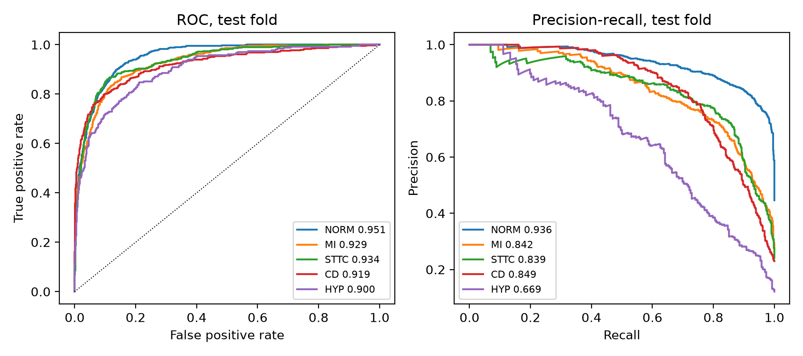

# ECG Analyzer

Multi-label classification of 12-lead electrocardiograms with a hybrid CNN-LSTM, with a desktop app that reads ECG recordings from audio files.

Five diagnostic superclasses of [PTB-XL](https://physionet.org/content/ptb-xl/) are scored independently, so one recording can receive several:

| Class | Meaning |
|---|---|
| NORM | Normal ECG |
| MI | Myocardial infarction |
| STTC | ST/T change |
| CD | Conduction disturbance |
| HYP | Hypertrophy |

> Research demonstration only. Not a medical device and not for diagnosis.

## App

- macOS: open `ECG Analyzer.app`
- Windows: open `ECG Analyzer.bat` (the first run installs `requirements-app.txt`)
- Any system: `python -m ecgpit.desktop`, or `python -m ecgpit.infer recording.wav` in a terminal

Try the files in `samples/`.

### Input

| Type | Requirement |
|---|---|
| WAV | 12 channels (I, II, III, aVR, aVL, aVF, V1 to V6), 100 Hz, 5 s to 5 min, 1 unit = 1 microvolt |
| MP4, M4A, MOV, AAC, MP3, FLAC, AIFF, WMA | made with **Save as audio** in the app, or `python -m ecgpit.audio in.wav out.mp4` |

Longer recordings are split into 10 s parts and averaged. Music, speech and microphone recordings of a heartbeat are not ECG and are refused.
Every file is checked for lead count, sampling rate, length, signal, voltage scale and limb-lead consistency before it is classified.

Ordinary converters drop leads and audio codecs discard slow signals, so compressed files carry the leads one after another, sped up into the audible band, between calibration sweeps that restore timing and voltage.

## Setup

    uv venv --python 3.12 .venv
    uv pip install --python .venv/bin/python -e . PySide6-Essentials

To use only the app: `pip install -r requirements-app.txt && pip install -e . --no-deps`.

## Reproduce

Put `ptbxl_database.csv`, `scp_statements.csv` and `records100/` from PTB-XL 1.0.3 in `data/raw/ptbxl/`, then:

    python -m ecgpit.convert       # lossless WAV files, verified sample by sample
    python -m ecgpit.data          # validate, label, cache
    python -m ecgpit.train --model cnn_lstm --input wav --seed 0
    python -m ecgpit.export_onnx   # best validation run to models/
    python -m ecgpit.report        # tables and figures in results/

`--model` is `cnn_lstm`, `cnn` or `lstm`. `--input peak` removes absolute voltage and `--limit N` trains on a subset, both for ablation.

## Method

- **Split:** the patient-wise folds of PTB-XL. Folds 1 to 8 train, 9 selects the epoch and thresholds, 10 is tested once.
- **Preprocessing:** each lead is centered and divided by a fixed voltage, identical in training and in the app.
- **Model:** strided 1-D convolution blocks, a bidirectional LSTM, fully connected layers and five sigmoid outputs.
- **Training:** binary cross-entropy, AdamW, early stopping on validation macro ROC-AUC.
- **Deployment:** ONNX Runtime. The app needs no PyTorch.

## Results

Current numbers live in [`results/summary.csv`](results/summary.csv) (all models, mean and standard deviation over seeds) and [`results/per_class.csv`](results/per_class.csv) (deployed model). Figures are next to them and every run is in `runs/`.

## Layout

| Path | Content |
|---|---|
| `src/ecgpit/` | data, models, training, inference, audio formats, desktop app |
| `models/` | deployed ONNX model and its thresholds |
| `runs/`, `logs/`, `results/` | weights, training logs, evaluation |
| `samples/` | demo recordings from the test fold |

## Credits

PTB-XL: P. Wagner et al., version 1.0.3, PhysioNet, [CC BY 4.0](https://creativecommons.org/licenses/by/4.0/). Files in `samples/` are converted from it.
The CNN-LSTM design is informed by A. Eleyan and E. Alboghbaish, *Computers* 2024, 13, 55, [doi:10.3390/computers13020055](https://doi.org/10.3390/computers13020055).
